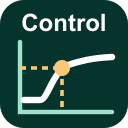

# Modbus Control

A Windows desktop client for reading and writing Modbus TCP registers, with a live trend graph,
measurement cursors and a step-response analysis view. It comes with a test server that simulates
signals.

## Download

Get the installer from the [latest release](https://github.com/francisboudreau7/modbus-control/releases/latest)
and run it (Windows 10/11, 64-bit). Start with the [Quick Start](docs/QUICK_START.md), then see the
[User Guide](docs/USER_GUIDE.md) for every option.

En français : [Guide de démarrage rapide](docs/fr/GUIDE_DEMARRAGE_RAPIDE.md) ·
[Guide de l'utilisateur](docs/fr/GUIDE_UTILISATEUR.md).

## Features

- Holding registers (FC03 read, FC06/FC16 write) and input registers (FC04 read)
- `int16`, `uint16`, `int32`, `uint32` and `float32` values with gain/offset scaling and a selectable
  byte order (ABCD, CDAB, BADC, DCBA)
- Live trend with two cursors (Δt, ΔY), zoom, pan and a second Y axis
- Analysis panel for step tests: K, L and T of a first-order model with dead time, from the cursors,
  with method presets (0 % / 63.2 %, Smith, Sundaresan-Krishnaswamy, custom), plain-language checks,
  a tuning calculator (Ziegler-Nichols, Cohen-Coon, IMC / lambda, SIMC) and tooltips that show the
  formulas with your numbers
- Safe writes: confirmation, per-tag Min/Max limits, checks for 32-bit values, one-click Quick A/B
  presets; 32-bit values are always written with one FC16 request
- Add tag dialog: reads the register and detects whether it holds a 16-bit value or a float32
  before the tag is added
- Encoding detection: works out the type and byte order of 32-bit values from what the device
  sends, flags 16-bit tags that sit on half of a float32, and asks before writing until confirmed
- Export of the graph (PNG, SVG, PDF) and of the data and analysis results (CSV)
- Projects (`.mbproj`) and recorded sessions (`.mbsession`) to review offline
- Test server `modbus_test_server` with simulated signals and fault injection
  ([docs/TEST_SERVER.md](docs/TEST_SERVER.md))

## Try it

Start the test server, then open the demo project and click **Connect**:

```bat
modbus_test_server.exe --port 1502
modbus_control.exe examples\demo.mbproj
```

Write a new value to **Setpoint** and watch **Lag** follow it, then measure its step response in the
**Analysis** panel.

## Build from source

Requirements: Visual Studio 2022 Build Tools (C++), CMake 3.25+ and Ninja, [vcpkg](https://vcpkg.io)
with `VCPKG_ROOT` set (installs libmodbus), and Qt 6.10.3 `msvc2022_64`:

```bat
pip install aqtinstall
aqt install-qt windows desktop 6.10.3 win64_msvc2022_64 -O C:\Qt
```

From an "x64 Native Tools Command Prompt for VS 2022":

```bat
cmake --preset msvc-debug
cmake --build --preset msvc-debug
ctest --preset msvc-debug
```

Qwt 6.3.0 is downloaded and built during configuration. Binaries land in `build\<preset>\bin`. Use
`msvc-release` for a release build, and `-DQT_ROOT=<path>` for another Qt location. The installer is
built with `installer\build_installer.ps1` (Inno Setup 6; see [installer/README.md](installer/README.md)).

## License

MIT (see [LICENSE](LICENSE)). Modbus Control links dynamically to Qt 6 (LGPL-3.0), Qwt 6.3
(Qwt License) and libmodbus (LGPL-2.1+).
